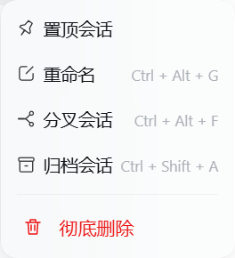

# 临时对话 · 无记忆

给 DeepSeek Harness 的一段独立对话空间：**保留完整工具能力与当前上下文，不带入旧记忆，也不把这里的内容存为长期记忆。**

输入框旁是一个紧凑入口，点击展开紫色光晕卡片；设置页提供独立开关。支持浅色、深色主题和减少动画的系统偏好。


## 功能

- 沿用当前模型、思考强度、工作目录、工作空间、代理预设与工具权限。
- 文件、终端、联网、子代理等常规工具继续可用，仍遵循原有权限设置。
- 当前对话及其子代理不读取、注入、提取或写入适配后的长期记忆。
- 普通对话的记忆检索会排除这些临时记录。
- 对话记录正常保存，关闭、重启都不自动删除；由你通过 Harness 的对话管理功能管理。
- 关闭设置开关会隐藏新建入口；已有临时对话仍保留模式标记与保护。
- 网络中断后重试会继续完成同一条对话，避免重复建空白对话。
- 临时会话的三个点菜单提供「彻底删除」。确认后清理本机聊天记录、子代理记录、投影缓存与检索索引；运行中的任务需明确确认停止。

模式从**新建对话**开始。已经读过历史记忆的普通对话不能直接转换。

## 安装

已验证的 Harness 版本：`0.2.0-rc.2`；Node.js 22 或更新版本。

```sh
dsh plugin --profile desktop add github:oudi85/dsh-temporary-chat
```

重启 Harness，在输入框旁点击「临时对话」。可在「设置 → 临时对话」启用或关闭入口。

本地源码安装：

```sh
dsh plugin --profile desktop add "file:/绝对路径/dsh-temporary-chat"
```

### 配合自动记忆插件

正在使用 [`@a9i5k4/dsh-auto-memory`](https://github.com/Aik358/dsh-auto-memory) 时，**需要同时安装记忆隔离适配**。仅隐藏记忆工具无法停止该插件的自动注入与后台整理。未适配时，本插件会显示原因并阻止新建临时对话。

关闭 Harness 后，在本仓库目录执行以下预检。将目录改成你实际安装的记忆插件目录；Windows 桌面默认位置通常是 `%USERPROFILE%\.dsh\profiles\desktop\node_modules\@a9i5k4\dsh-auto-memory`：

```sh
node scripts/integrate-auto-memory.mjs --plugin-dir "记忆插件的绝对目录"
```

预检通过后应用：

```sh
node scripts/integrate-auto-memory.mjs --plugin-dir "记忆插件的绝对目录" --apply
```

脚本逐一校验接入位置，全部匹配才修改；先备份原文件，以替换文件的方式避免修改包管理器的硬链接源。支持 `3.2.8` 系列的兼容源码和上游 `3.2.10`，其他版本停止修改并提示。已接入相同适配的版本无需重复安装。

撤销适配：

```sh
node scripts/integrate-auto-memory.mjs --plugin-dir "记忆插件的绝对目录" --restore
```

恢复前检查文件是否被后续修改，不覆盖你的新改动。适配不会改动记忆内容、账户、聊天记录或计费记录。记忆插件更新、重装后需再次预检和适配；入口的兼容提示会帮助确认。

## 记忆与保存的边界

这里的「临时」表示**与长期记忆隔离**，不是自动销毁聊天记录。Harness 的原生聊天记录仍会保存，当前对话的上下文也继续使用。工具对文件或外部服务产生的正常操作遵循你的指令与现有权限。

已支持上述自动记忆插件。其他第三方记忆插件需要自行接入注册表和隔离检查，本插件不能自动禁止任意未知插件的后台写入。

### 彻底删除

鼠标移到左侧临时会话上，点击三个点 → **彻底删除**。确认窗口会显示子代理会话数量；取消不会改动记录。对话正在运行时，确认按钮改为「停止并彻底删除」。普通对话不显示此入口。




删除会清理该会话和所属子代理的原生记录、投影缓存、历史检索条目，以及工作区中的会话登记。独立分叉的对话、工作区文件、共享附件文件和计费记录保留。已删除会话的 ID 标记保存在本机，阻止旧窗口重新创建同一个会话；标记不含聊天内容。其他软件的导出副本或你自行制作的备份不在删除范围内。

仅支持已验证的 Harness 原生 JSONL 会话存储；目录异常、链接路径或未释放的会话会停止删除并提示。入口关闭后，现有临时会话仍可通过三个点菜单删除。

## 开发与验证

```sh
npm test
```

测试只用 Node.js 内置模块，不调用模型、不消耗额度。覆盖模式持久化、子代理继承、权限快照、开关、普通工具保留、重试恢复、适配冲突与恢复保护，以及删除确认、子代理范围、运行保护、路径检查、缓存清理和删除后的防复活。CI 在 Windows 和 Linux 上运行。

Host 接口使用 Harness 的内部会话控制服务；升级 Harness 后需重新验证创建、权限继承和界面导航。兼容逻辑位于 `lib/index.js`，界面位于 `lib/client.js`，记忆适配位于 `integration/`。

## 许可证

插件原创代码使用 MIT。记忆插件适配规则包含上游 BSD-3-Clause 代码上下文，见 [NOTICE](NOTICE)。
